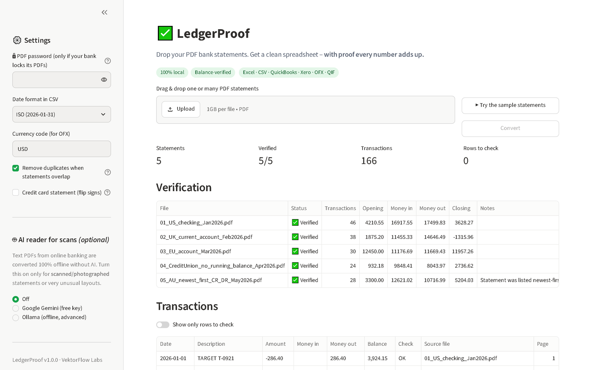

# LedgerProof: PDF bank statement to Excel, verified against the balances

**Website and free download: https://vektorflow-labs.github.io/ledgerproof/**

LedgerProof converts PDF bank statements into Excel, CSV, QuickBooks Online CSV, Xero CSV, OFX and QIF on your own computer (Windows, macOS, Linux). After extracting the transactions it checks every row against the running balance and the closing balance printed on the statement, so a misread amount or a missing transaction is flagged instead of slipping into your books.

## What it does

- **No per-bank templates.** It finds the date and amount columns from where the words sit on the page and keeps the reading in which the running balances add up.
- **Every row verified.** Rows that don't match the printed balance are flagged for review.
- **Offline.** Statements never leave your computer. No account, no upload, no telemetry.
- **Many statements at once.** Duplicates between overlapping statements are removed.
- **Formats:** US, UK, EU and Spanish-language statements (`1,234.56` and `1.234,56`, `31/01/2026`, `01/MAR/2026`), debit/credit columns or a signed amount, CR/DR, newest-first lists, dates printed once per day, wrapped descriptions, zero-decimal currencies.
- **Scanned statements (optional):** an AI reader using your own Google Gemini key or a local Ollama model. Its output goes through the same balance check.
- Interface in English and Spanish.

## Free tools

- [Free bank reconciliation template for Excel](https://vektorflow-labs.github.io/ledgerproof/free-bank-reconciliation-template-excel.html): checks each statement row against the printed balance and reconciles the bank with your books.
- [How to convert a PDF bank statement to Excel](https://vektorflow-labs.github.io/ledgerproof/pdf-bank-statement-to-excel.html) with free methods (Power Query, Tabula) and a one-minute check formula.
- [Bank statement to QuickBooks Online CSV](https://vektorflow-labs.github.io/ledgerproof/bank-statement-to-quickbooks-csv.html) · [Xero CSV](https://vektorflow-labs.github.io/ledgerproof/bank-statement-to-xero-csv.html) · [OFX / QIF](https://vektorflow-labs.github.io/ledgerproof/pdf-bank-statement-to-ofx-qif.html)
- [How to reconcile a bank statement in Excel](https://vektorflow-labs.github.io/ledgerproof/reconcile-bank-statement-in-excel.html)

## Pricing

- **LedgerProof Lite:** free. Converts 2 statements at a time to Excel and CSV, with the same balance check.
- **LedgerProof:** USD 29, one-time payment, no subscription. Adds batch conversion, QuickBooks and Xero CSV, OFX, QIF and the scanned-statement reader.

Get either one at **https://vektorflow-labs.github.io/ledgerproof/**

---

## En español: extractos bancarios PDF a Excel

LedgerProof convierte extractos bancarios en PDF a Excel, CSV, QuickBooks, Xero, OFX y QIF en tu propia computadora, y compara cada movimiento con los saldos impresos en el extracto: si una fila se leyó mal o falta, queda marcada. Funciona sin conexión, entiende importes como `1.234,56` y fechas como `31/01/2026`, y la interfaz está en español.

- [Conversor de extractos bancarios PDF a Excel](https://vektorflow-labs.github.io/ledgerproof/conversor-extractos-bancarios-pdf-excel.html) (versión gratis)
- [Plantilla de conciliación bancaria en Excel, gratis](https://vektorflow-labs.github.io/ledgerproof/plantilla-conciliacion-bancaria-excel.html)
- [Cómo convertir un extracto bancario PDF a Excel](https://vektorflow-labs.github.io/ledgerproof/convertir-extracto-bancario-pdf-a-excel.html)

---

This repository hosts the LedgerProof website. © VektorFlow Labs.
